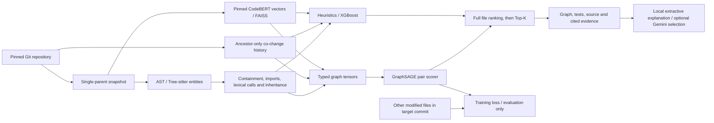

# Implemented architecture

Neural Cartographer is a local change-impact exploration system for Python repositories. FastAPI serves a React/Vite workspace and reads immutable Git snapshots. The study uses the user-confirmed seven training, two validation and three held-out repositories. Source extraction and analysis never execute target repository code.

## Data and identity

`ingest/pipeline.py` clones the pinned revision, extracts file/class/function/test nodes, and records non-merge history and parent-side co-change queries. AST-equivalent formatting changes are excluded; uncertain/unparseable changes are retained. Version 5 fixes indentation-sensitive filtering. SQLite caches persist blob AST signatures. Summary checksums and `ingest/verify.py` validate pins, partitions, query parent identity, labels and artifact integrity.

Historical graphs are rebuilt from the target commit's parent. `graph/relations.py` adds conservative same-file, unshadowed lexical calls and inheritance. Dynamic or ambiguous resolution remains unresolved. `features/history.py` uses only reachable ancestors of the graph revision. `features/embeddings.py` uses a pinned CodeBERT revision, content-addressed blob vectors, and checksummed revision-specific matrices/indexes.

`contracts/schema.py` supplies revision-aware hashed identities and explicit compatibility IDs. Persisted graph edges still use legacy local IDs; API entity records expose the hashed identity separately. This compatibility boundary is not a completed storage migration. Git rename aliases and parent-side spans are available through `labels/diffs.py`; ambiguous and inserted regions retain a file fallback.

## Ranking and study

All systems score the same complete eligible-file pool, excluding the seed. Structural/history/directory/semantic channels describe evidence rather than pruning candidates. Six heuristics, semantic similarity and XGBoost provide comparisons. `learning/heterogeneous.py` encodes four node types and eleven directed relation channels with two relation-aware GraphSAGE layers. File vectors are shared with contained symbols, while the pair scorer predicts related files.

`learning/train.py` uses fixed seeds, hard/random negatives, weighted BCE, gradient clipping, early stopping, separate validation selection/calibration commits and retrained single-channel ablations. Prepared examples and exact-input epoch checkpoints persist across interruptions. The bounded development configuration uses up to 140 training, 20 selection and 20 calibration queries; it does not train on every extracted query.

`learning/research.py` freezes data/configuration/code/model checksums before held-out access. Final evaluation records repository-macro and per-project ranking metrics, hierarchical bootstrap intervals, calibration, inference latency and the strongest-baseline success gate. Success is a measured result, not a condition the implementation can guarantee. The protocol uses project-disjoint evaluation; it does not establish global chronological separation between different projects or audit CodeBERT pretraining overlap.

## Product and operations

`api/app.py` exposes catalog, snapshots, seeds, analysis, bounded pinned-source previews, model readiness, research provenance, explanations and ingestion jobs. API graph responses contain at most 500 nodes. `contracts/api_models.py` defines the principal version-one response types.

`jobs/store.py` coordinates local worker processes through transactional SQLite records. `jobs/worker.py` runs bounded ingestion subprocesses, reports progress, honors cross-worker cancellation and records failures. Retry and refresh recovery are exposed in the UI. `scripts/start.py` handles Windows paths containing spaces and serves the built frontend on localhost.

The React workspace separates repository navigation, analysis configuration, ranked graph/evidence, source previews, test suggestions, connections and Model Lab. It provides responsive layouts, loading/error/empty states, JSON export and polling for catalog/model readiness. `evidence/explain.py` renders only server-derived statements with citations. Optional Gemini selects known IDs; provider-authored claims are never rendered.

See `operations.md` for recovery and limits, `data-contract.md` for schema boundaries, and `implementation-status.md` for executed acceptance evidence. Function-level predictions, external benchmark studies and optional Neo4j are separate from the verified file-ranking flow.
